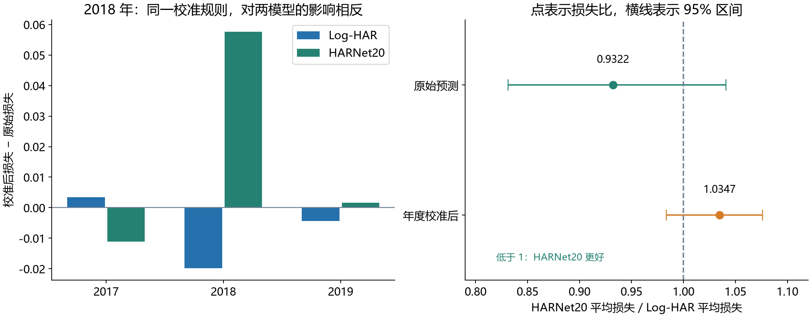
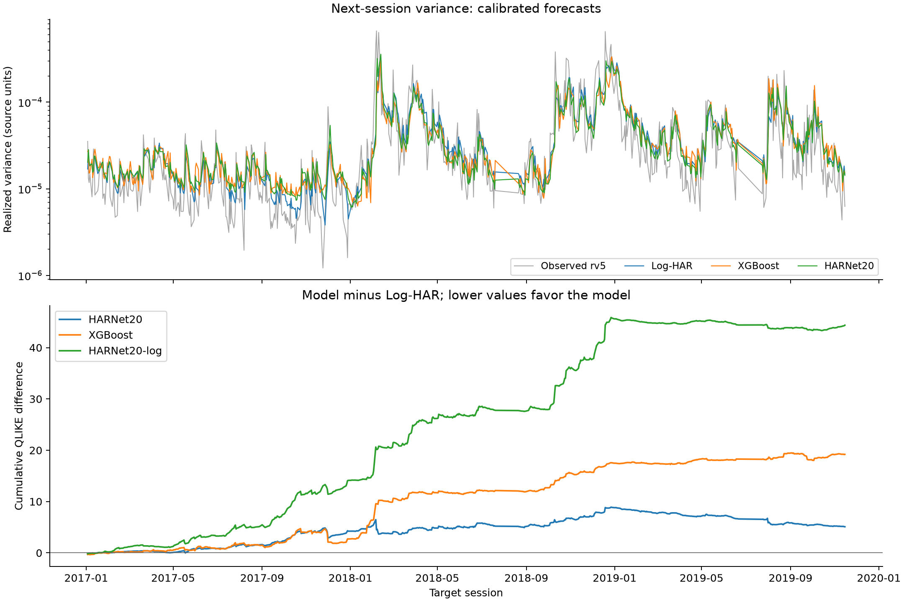

# 标普 500 已实现方差预测

本项目完成了 Log-HAR、XGBoost 和 HARNet20 对标普 500 下一交易日日内已实现方差的预测实验。三个模型使用相同的二十个交易日输入，按年度扩展窗口重新拟合，并比较原始预测与年度校准后的表现。

数据覆盖 2000–2019 年，样本外评价覆盖 2017–2019 年，共 682 个预测日期。评价指标为 QLIKE 和 log-RMSE，统计推断采用配对移动区块 bootstrap。

[项目数学讲解](docs/项目讲解.md) · [实验报告](results/report.md) · [研究方案](volatility_project_proposal.pdf)

## 已完成的工作

- 读取 Oxford–Man 档案中的 SPX 数据，按 XNYS 交易日历构造完整窗口。
- 实现 Log-HAR、采用 log link 和 QLIKE 目标的 XGBoost、13 参数的 PyTorch HARNet20。
- 保留水平 HAR 的 OLS 初始化器，并完成 HARNet20 的 QLIKE / 平方 log 误差损失消融。
- 完成三折年度扩展验证、五种子集成、年度模型重估和年度乘法校准。
- 生成逐日预测、总体与年度评分、高波动起点评分、完整交易时段评分。
- 完成 5,000 次配对移动区块 bootstrap，报告损失比、损失差及 95% 区间。
- 完成朴素基准比较、校准损失分解、固定滤波器对照和延长验证训练的诊断。

## 数据

数据来自 HARNet 作者仓库中的 Oxford–Man 档案，使用快照 `3b2832f163ec52cab2435163e82f2e816ae348c9`。

- 原始档案：[MAN_data.csv](https://raw.githubusercontent.com/mdsunivie/HARNet/3b2832f163ec52cab2435163e82f2e816ae348c9/data/MAN_data.csv)
- 仓库内文件：[data/raw/MAN_data.csv](data/raw/MAN_data.csv)
- 标的：`.SPX`，标普 500。
- 目标字段：`rv5`，由五分钟日内收益构造的已实现方差，保留源数据单位。
- 输入：前二十个连续交易日的方差；目标：下一交易日的方差。

| 样本 | 数量 |
|---|---:|
| 2000–2019 年 SPX 观测 | 5,017 |
| 缺失交易日 | 14 |
| 完整预测窗口 | 4,781 |
| 初始拟合，目标年份 2000–2013 | 3,343 |
| 验证，目标年份 2014–2016 | 756 |
| 样本外评价，目标年份 2017–2019 | 682 |

数据读取保留书写的日期标签，检查重复日期、交易日、方差和观察数。窗口中任意输入日或目标日缺失时，排除该窗口。提前收市保留，另报告完整交易时段的结果。

2020–2025 年扩展数据尚未接入。当前实验和结论对应 2017–2019 年。

## 实验设计

Log-HAR 对 log 方差的日、五日和二十日均值作 OLS，并将预测指数还原。XGBoost 使用二十个 log 方差滞后与 HAR 汇总特征。HARNet20 使用核长 5/4、扩张率 1/5 的两层单通道卷积，以水平 HAR 的 OLS 系数初始化。

初始拟合使用 2000–2013 年目标，2014–2016 年用于逐年扩展验证。设置在 2017 年评价开始前固定。每个预测年使用截至上一年底的目标重新拟合，年内权重固定、输入逐日更新。

| 设置 | 取值 |
|---|---|
| XGBoost 候选组合 | 深度 2/3/4，学习率 0.03/0.10，最小子节点权重 1/10，共 12 组 |
| XGBoost 验证规则 | 最多 2,000 轮，QLIKE 早停，耐心 50 |
| XGBoost 最终设置 | 深度 4，学习率 0.10，最小子节点权重 10，43 轮 |
| HARNet 优化器 | Adam，学习率 0.0001，批次 64，无权重衰减 |
| HARNet 验证规则 | 最多 200 epoch，按 QLIKE 早停，耐心 20 |
| HARNet 最终轮数 | QLIKE 版本 197 epoch；平方 log 误差版本 5 epoch |
| 随机种子 | 11、22、33、44、55 |
| 集成 | 五个方差预测的算术平均 |

XGBoost 按合并验证日期的平均 QLIKE 选择参数，固定轮数取获选参数三折最佳轮数的中位数。HARNet 的固定 epoch 数取三折、五种子最佳 epoch 的中位数，包含 epoch 0 的 OLS 初始化。

每次拟合以训练目标的平均方差缩放，HARNet 的缩放输出下限为 `1e-8`。各模型用前一年原始样本外预测计算 `c = mean(actual / prediction)`，再将当年预测乘以该系数。2017 年的系数来自 2016 年验证预测。

主要比较为校准后的 HARNet20 / Log-HAR 平均 QLIKE 比值。bootstrap 在每个预测年份的交易日网格内配对重采样，保留缺失日期标记，主区块长 20 个交易日，另报告 10 日和 40 日结果。

## 结果

QLIKE 和 log-RMSE 均为损失指标，数值越低越好。

| 模型 | 原始 QLIKE | 校准 QLIKE | 原始 log-RMSE | 校准 log-RMSE |
|---|---:|---:|---:|---:|
| Log-HAR | 0.22197 | **0.21529** | **0.60622** | **0.65407** |
| XGBoost | 0.21929 | 0.24344 | 0.67986 | 0.69462 |
| HARNet20 | **0.20692** | 0.22277 | 0.67756 | 0.66519 |
| 水平 HAR 初始化器 | 0.27084 | 0.29941 | 0.82323 | 0.75944 |
| HARNet20，平方 log 误差 | 0.22964 | 0.28036 | 0.69182 | 0.73361 |

原始 HARNet20 的 QLIKE 比 Log-HAR 低 6.8%，损失比为 0.9322，95% 区间为 [0.8313, 1.0410]。校准后损失比为 1.0347，95% 区间为 [0.9836, 1.0761]。预设主要比较未达到区间完全低于 1 的改善判定标准。

原始 HARNet20 的 QLIKE 比“明天等于今天”基准低 15.8%，该比较的 95% 损失比区间为 [0.7510, 0.9222]。年度校准后，HARNet20 没有优于同样校准的这一基准。

损失分解显示，2018 年校准将 HARNet20 预测整体乘以 0.7415，使该年 QLIKE 从 0.19805 升至 0.25568。五种子差异较小，固定滤波器和延长训练的对照结果见 [results/diagnostics](results/diagnostics)。





## 运行

运行环境为 Python 3.12 和 CPU。依赖见 [requirements.txt](requirements.txt)，已完成实验的具体环境和依赖版本见 [results/runtime.json](results/runtime.json)。

在项目根目录执行以下命令。

### Windows

```powershell
python -m venv .venv
.venv\Scripts\python.exe -m pip install -r requirements.txt
.venv\Scripts\python.exe run.py --download
```

### macOS / Linux

```bash
python3 -m venv .venv
.venv/bin/python -m pip install -r requirements.txt
.venv/bin/python run.py --download
```

主实验读取 `config.json`，结果写入 `results/`。`--download` 在本地档案不存在时下载指定快照。重复运行会更新结果文件。

Windows 下的补充分析命令：

```powershell
.venv\Scripts\python.exe compare_baselines.py
.venv\Scripts\python.exe diagnose_results.py
```

`compare_baselines.py` 使用保存的预测和交易日网格补算基准评分。`diagnose_results.py` 复现种子 11，运行固定滤波器与延长验证训练的对照。

## 文件结构

```text
.
├── README.md
├── config.json
├── requirements.txt
├── run.py
├── compare_baselines.py
├── diagnose_results.py
├── compare_sources.py
├── volatility/
│   ├── data.py
│   ├── models.py
│   ├── experiment.py
│   └── evaluation.py
├── data/raw/MAN_data.csv
├── docs/
│   ├── 项目讲解.md
│   └── figures/
├── results/
│   ├── report.md
│   ├── predictions.csv
│   ├── scores.csv
│   ├── inference.csv
│   ├── diagnostics/
│   └── baselines/
└── volatility_project_proposal.pdf
```

| 入口 | 内容 |
|---|---|
| [docs/项目讲解.md](docs/项目讲解.md) | 数学原理、模型、训练、校准、区间和代码对应关系 |
| [results/report.md](results/report.md) | 原始实验报告 |
| [results/predictions.csv](results/predictions.csv) | 逐日目标、原始及校准预测、五个种子 |
| [results/scores.csv](results/scores.csv) | 总体、年度、高波动起点及完整交易时段评分 |
| [results/inference.csv](results/inference.csv) | 主次比较及区块长度敏感性 |
| [results/baselines/scores.csv](results/baselines/scores.csv) | 朴素基准、模型评分及误差范围内日期比例 |
| [results/baselines/inference.csv](results/baselines/inference.csv) | 相对朴素基准的改善和区间 |
| [results/diagnostics/calibration_decomposition.csv](results/diagnostics/calibration_decomposition.csv) | 年度校准损失分解 |
| [results/diagnostics/head_only_summary.csv](results/diagnostics/head_only_summary.csv) | 固定滤波器对照 |
| [results/diagnostics/extended_validation.csv](results/diagnostics/extended_validation.csv) | 延长验证训练对照 |
| [results/data_audit.csv](results/data_audit.csv) | 年度覆盖与完整窗口数 |

## 参考

- [Reisenhofer, Bayer and Hautsch：HARNet](https://arxiv.org/abs/2205.07719)
- [HARNet 原始实现与数据档案](https://github.com/mdsunivie/HARNet)
- [XGBoost 自定义目标接口](https://xgboost.readthedocs.io/en/stable/tutorials/custom_metric_obj.html)
