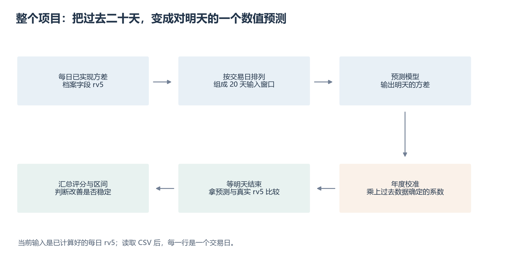
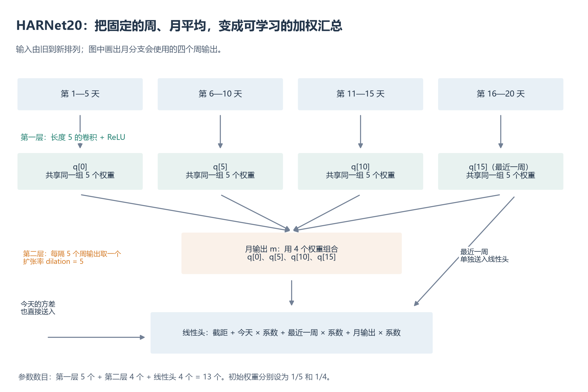
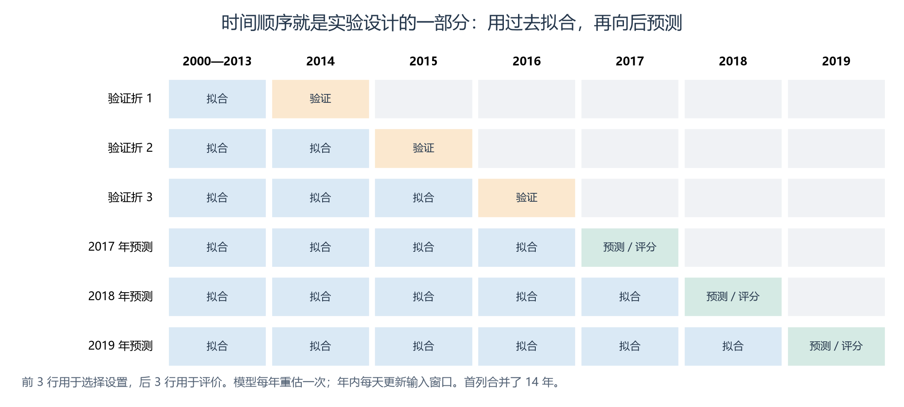
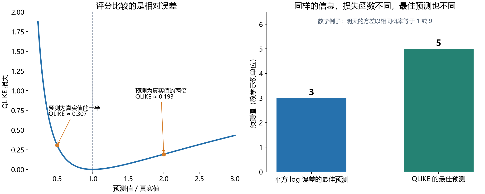
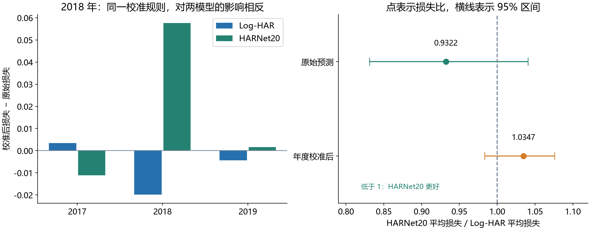

# 从数学到代码：读懂这个波动预测项目

这份讲解按本科阶段的函数、求导、矩阵乘法和基础概率来写；代码部分只需要理解数组、循环和函数。先抓住每一步在解决什么问题，再看公式和实现。

**整个项目研究一个问题：知道标普 500 过去二十个交易日的波动后，能否更准确地预测下一交易日的波动？**

具体预测量是“日内已实现方差”，记作 $v_t$。文件夹沿用了 `VIX prediction` 这个名字；当前方案与代码的目标变量都是标普 500 的 `rv5`。目前已完成公开档案上 2017—2019 年的预测实验及结果诊断。

建议按下面的顺序阅读：第 1—3 节理解任务和数据，第 4—6 节理解模型，第 7—9 节理解实验与评分，第 10—12 节对应本项目的结果与代码。



## 1. 每天到底预测什么？

### 1.1 涨跌与波动是两个不同的问题

假设一小段时间里的价格依次是：

```text
100 → 101 → 100
```

最后价格回到了 100，但中间经历了一次上涨和一次下跌。波动描述的就是这种变化幅度。

把一天分成五分钟的小段，记各段末端价格为 $P_0,P_1,\ldots,P_M$。第 $j$ 段的 log 收益为：

$$
r_j=\log\frac{P_j}{P_{j-1}}.
$$

当涨跌幅不大时，它近似于通常说的百分比收益。例如，100 涨到 101，log 收益约为 0.00995，接近 1%。

把当天各段收益的平方相加：

$$
v_t=\sum_{j=1}^{M}r_{t,j}^{\,2}.
$$

这就是本项目所用已实现方差的基本构造。平方让上涨和下跌都贡献正数，变化幅度越大，平方和通常越大。这里累积的是一整天的变化量，所以公式是收益平方和。

在上面的两段教学例子中：

$$
v\approx0.00995^2+(-0.00995)^2\approx0.000198.
$$

即使总涨跌接近零，已实现方差仍然为正。

### 1.2 方差和波动率怎样换算？

波动率是方差的平方根：

$$
\text{波动率}=\sqrt v.
$$

如果 $v=0.0001$，则 $\sqrt v=0.01=1\%$。本项目的模型与 QLIKE 评分都在**方差尺度**上工作，读取和保存的也是原始方差单位。

目标覆盖开盘到收盘的日内变化。隔夜从前一日收盘到次日开盘的价格跳变没有加入这个目标。

### 1.3 代码有没有重新计算五分钟收益？

当前公开 CSV 已经提供了每天的 `rv5`。代码读取这个现成的日度统计量；本节的五分钟价格公式用于说明它的来源。

主要字段可以这样理解：

| 字段 | 在本项目中的用途 |
|---|---|
| `date` | 确定是哪一个交易日 |
| `Symbol` | 选择标普 500，档案代码为 `.SPX` |
| `rv5` | 五分钟收益构造的日度已实现方差，作为输入和目标 |
| `nobs` | 档案记录的观察数，用于检查数据质量 |

## 2. 怎样把时间序列变成机器学习样本？

在交易日 $t$ 收盘后，最近二十个交易日的方差已经可以观察到。将它们排列成一个向量：

$$
x_t=(v_{t-19},v_{t-18},\ldots,v_t)\in\mathbb R^{20}.
$$

希望预测的标签是：

$$
y_t=v_{t+1}.
$$

于是，每一条样本都是“二十个输入数，加上一个下一日答案”。

```text
样本 1：[第  1 天，……，第 20 天] → 第 21 天
样本 2：[第  2 天，……，第 21 天] → 第 22 天
样本 3：[第  3 天，……，第 22 天] → 第 23 天
```

代码里的 `x` 是一个 `样本数 × 20` 的二维数组，`y` 是长度等于样本数的一维数组。比如初始拟合阶段，形状是：

```python
x.shape == (3343, 20)
y.shape == (3343,)
```

这也说明相邻样本会共享十九天输入，它们之间存在很强的联系。后面做统计区间时，要保留这种时间联系。

### 为什么要按交易所日历排列？

这里的“二十天”指连续二十个交易日。周末本来就没有交易，但一个应该交易却缺少观测的日期，需要保留为空位。

例如档案缺了某个星期二：若直接把它删掉，星期一和星期三就会被当作连续的两条观测；一个窗口实际覆盖的交易日数可能发生变化。当前实现先建立纽约证券交易所的交易日网格，再把数据放进去。

**输入二十天和目标一天中，只要任意一天缺失，就舍去该样本。** 这会让少量缺失日期影响多个窗口。

最后得到的样本数与技术方案一致：

| 项目 | 数量 |
|---|---:|
| 2000—2019 年有效 SPX 日度观测 | 5,017 |
| 交易日网格中缺失的日期 | 14 |
| 完整的“20 天输入＋下一天目标”样本 | 4,781 |
| 初始拟合样本，目标年份 2000—2013 | 3,343 |
| 验证样本，目标年份 2014—2016 | 756 |
| 最终评价样本，目标年份 2017—2019 | 682 |

## 3. 先区分三个概念：模型、损失函数、校准

理解这个项目，最重要的是把这三件事分开。

| 概念 | 数学形式 | 在做什么 |
|---|---|---|
| 模型 | $\hat v=f_\theta(x)$ | 规定怎样由输入算出预测 |
| 损失函数 | $L(v,\hat v)$ | 规定什么样的预测误差代价更大 |
| 校准 | $\tilde v=c\hat v$ | 预测生成后，整体调整其水平 |

这里 $\theta$ 是需要从训练数据估计的参数。比如线性回归里的回归系数、树里的分裂和叶子值、卷积里的权重，都属于参数。

训练就是选择一组参数，让训练数据上的平均损失尽量小：

$$
\hat\theta\approx\arg\min_\theta\frac1N\sum_{i=1}^{N}L\bigl(y_i,f_\theta(x_i)\bigr).
$$

三个模型使用同一批二十天输入，但转换输入的方法不同。它们的训练损失也有区别。预测完成后，再按方案进行年度校准。

## 4. Log-HAR：把过去压缩成“今天、近一周、近一月”

HAR 的直觉是：市场波动可能同时具有短期和较长期的持续性，因此同时观察三个时间尺度。

令 $z_t=\log v_t$，构造：

$$
z_t,\qquad
\bar z_{5,t}=\frac15\sum_{j=0}^{4}z_{t-j},\qquad
\bar z_{20,t}=\frac1{20}\sum_{j=0}^{19}z_{t-j}.
$$

用它们预测明天的 log 方差：

$$
\hat z_{t+1}=\beta_0+\beta_1z_t+\beta_2\bar z_{5,t}+\beta_3\bar z_{20,t}.
$$

再指数还原为方差预测：

$$
\hat v_{t+1}=\exp(\hat z_{t+1}).
$$

可以把三个输入理解为“今天的状态”“这一周的背景”“这一月的背景”。系数决定每种信息在预测中的作用，截距 $\beta_0$ 决定整体水平。

这里平均的是 **log 方差**：先取 log，再取平均。它与“先平均方差，再取 log”是两种不同的计算。

### 它怎样和线性代数联系起来？

每个样本生成一行：

$$
(1,z_t,\bar z_{5,t},\bar z_{20,t}).
$$

将所有行堆叠成矩阵 $H\in\mathbb R^{N\times4}$，下一日 log 方差堆叠成向量 $b\in\mathbb R^N$，便得到：

$$
\hat\beta=\arg\min_\beta\|H\beta-b\|_2^2.
$$

这是普通最小二乘问题。满列秩时，可以写成 $\hat\beta=(H^TH)^{-1}H^Tb$；代码通过 `np.linalg.lstsq` 求解。

它需要估计的参数只有四个，所以结构容易解释。取 log 也压缩了极大方差与普通方差之间的数值差距。

## 5. XGBoost：让一组小树逐步修正预测

树模型可以根据输入作条件判断。例如下面是一个教学示意：

```text
最近一周的平均 log 方差是否很高？
├─ 是：今天又是否明显高于最近一周？
│      ├─ 是：给出较高预测
│      └─ 否：给出中等偏高预测
└─ 否：给出较低预测
```

真实模型的阈值和叶子值由训练数据学习。XGBoost 将许多棵小树相加：

$$
\eta(x)=\eta_0+\sum_{m=1}^{M}\alpha f_m(x).
$$

其中 $f_m$ 是第 $m$ 棵树，$\alpha$ 是学习率。每加一棵树，都尝试沿着当前损失的下降方向修正预测。

本项目给树模型提供二十个 log 方差滞后，以及 HAR 的汇总特征。为了输出正方差，树先预测一个实数 $\eta$，再计算：

$$
\hat v=\exp(\eta).
$$

这个从实数到正数的转换叫 **log link**。训练目标是后面要讲的 QLIKE。

参数搜索只在验证年份进行，考察树深度、学习率和最小子节点权重，共十二种组合。最终选到深度 4、学习率 0.10、最小子节点权重 10，年度拟合固定使用 43 轮。

## 6. HARNet20：让“平均”里的权重也可以学习

这里的 CNN 可以理解为一个**带有共享权重的局部加权求和器**。它处理的是一维时间序列。

### 6.1 从平均数走到卷积

五天的简单平均是：

$$
\frac15v_1+\frac15v_2+\frac15v_3+\frac15v_4+\frac15v_5.
$$

如果把五个固定的 $1/5$ 改成可学习的 $a_0,\ldots,a_4$，就得到：

$$
a_0v_1+a_1v_2+a_2v_3+a_3v_4+a_4v_5.
$$

将同样的五个权重滑到下一个五天片段上，再做一次加权求和，就是这里的卷积计算。**共享权重**意味着所有位置都使用同一组 $a$，所以参数数目很少。

数学上的平均要求权重相等且和为 1；训练后的卷积权重可以自由变化。因此“加权汇总”比“平均”更准确地描述训练后的计算。

### 6.2 两层怎样组合成二十天信息？

为了让训练数值容易处理，每次拟合先用训练目标的平均方差 $s$ 缩放：

$$
u_t=v_t/s.
$$

例如 $s=0.0001$，方差 0.0002 缩放后就是 2。网络内部在 $u$ 尺度上计算，输出后再乘回 $s$。这个缩放常数只从当次训练数据计算。



把二十个缩放后的输入记作 $u_0,\ldots,u_{19}$。第一层生成十六个滑动结果：

$$
q_j=\operatorname{ReLU}\left(\sum_{k=0}^{4}a_ku_{j+k}\right),\quad j=0,\ldots,15.
$$

其中 $\operatorname{ReLU}(x)=\max(0,x)$。最近一周对应 $q_{15}$。

第二层每隔五个位置取一个结果：

$$
m=\operatorname{ReLU}(b_0q_0+b_1q_5+b_2q_{10}+b_3q_{15}).
$$

这里的“扩张率 5”指在第一层的输出序列中隔五个位置取值。

为什么这样就能覆盖二十天？因为 $q_0,q_5,q_{10},q_{15}$ 分别汇总第 1—5、6—10、11—15、16—20 天。最后的线性头把今天、最近一周和月输出组合起来：

$$
\hat u=\max\left(10^{-8},\gamma_0+\gamma_1u_{19}+\gamma_2q_{15}+\gamma_3m\right),
\qquad \hat v=s\hat u.
$$

参数总数是 $5+4+4=13$。输出下限让 log 和除法始终有定义；保存的主实验记录中，这个下限没有被触发。

### 6.3 为什么要用 HAR 初始化？

一开始设 $a_k=1/5$、$b_k=1/4$，那么第一层就是五天平均，第二层就是二十天平均。再把线性头设为水平 HAR 的 OLS 系数，网络就从一个已经能预测的统计模型出发。

这里的“水平 HAR”直接对方差作回归：

$$
\hat u_{t+1}=\gamma_0+\gamma_1u_t+\gamma_2\bar u_{5,t}+\gamma_3\bar u_{20,t}.
$$

因此，HARNet20 初始化时复现的是**水平 HAR**。Log-HAR 则对 log 方差建模，两者的函数形式不同。

### 6.4 训练时到底发生什么？

训练循环的核心计算如下：

```python
optimizer.zero_grad()                # 清空上一批次的梯度
prediction = model(x_batch)          # 前向计算
loss = loss_function(y_batch, prediction)
loss.backward()                     # 用链式法则计算各参数的导数
optimizer.step()                     # 按导数更新参数
```

最基本的梯度下降形式是 $\theta\leftarrow\theta-\alpha\nabla_\theta L$。项目使用 Adam，它还会根据历史梯度调节各参数的更新幅度。

相关词汇可以这样理解：

| 名称 | 这里的含义 |
|---|---|
| batch，批次 | 一次用 64 条窗口样本计算更新 |
| epoch | 将当次训练样本遍历一遍 |
| learning rate | 更新步长，这里为 $10^{-4}$ |
| early stopping | 验证 QLIKE 连续 20 个 epoch 未改善时停止 |
| seed，随机种子 | 固定随机顺序，便于重复训练 |

五个种子的初始化系数相同，训练样本的打乱顺序不同。它们会产生略有区别的最终参数。主预测取五个**方差预测值的算术平均**：

$$
\hat v_t^{\mathrm{ensemble}}=\frac15\sum_{k=1}^{5}\hat v_t^{(k)}.
$$

验证阶段选定轮数后，年度预测阶段按固定轮数训练：QLIKE 网络为 197 个 epoch，平方 log 误差网络为 5 个 epoch。

## 7. 为什么训练、验证、最终评价要按时间分开？

预测任务要求模拟“当时能够知道什么”。因此，模型用过去拟合，再往未来评价。



三种数据角色分别是：

- **训练数据**：估计回归系数、树、卷积权重等模型参数。
- **验证数据**：选择树的设置和神经网络训练轮数。
- **最终评价数据**：在设置确定后，观察实际预测表现。

例如 2017 年的模型使用目标日期截至 2016 年底的样本拟合。2017 年内，模型参数保持不变；每天收盘后，将最新的已实现方差加入输入窗口，继续预测下一天。

进入 2018 年，再把已经观察到的 2017 年目标加入训练数据，重新拟合模型。这叫 **年度扩展窗口**：年份越往后，拟合样本越多。

因此，2017 年数据在预测 2017 年时属于最终评价数据，到预测 2018 年时就成为已知历史，可以参与拟合。

模型验证使用 2014、2015、2016 三个年度折。XGBoost 按合并验证日期的平均 QLIKE 选参数；固定轮数取获选设置三折最佳轮数的中位数。神经网络的固定 epoch 数取三折、五个种子的最佳 epoch 中位数。

## 8. QLIKE 为什么会改变“最佳预测”？

### 8.1 它是一把针对方差预测的评分尺

本项目的主要损失是：

$$
L(v,\hat v)=\frac{v}{\hat v}-\log\frac{v}{\hat v}-1.
$$

预测等于真实值时，损失为零。其余情况损失为正，越小越好。

令 $r=\hat v/v$，就可以写成：

$$
L=\frac1r+\log r-1.
$$

它关注预测与真实值的比例。如果把真实值和预测一起换成另一套相同倍数的单位，这个分数保持不变。

在教学例子中，预测只有真实值的一半，QLIKE 约为 0.307；预测是真实值的两倍，QLIKE 约为 0.193。相同倍数的低估和高估，代价不一样。



### 8.2 用一个概率例子理解损失函数

假设在今天已知信息下，明天的方差以相同概率等于 1 或 9。这里的数字是为了讲解而设定的单位。

若用平方 log 误差训练，最佳预测满足：

$$
\log\hat v=\mathbb E[\log v],\qquad
\hat v=\exp\left(\frac{\log1+\log9}{2}\right)=3.
$$

若用 QLIKE 训练，最佳预测是条件算术平均：

$$
\hat v=\mathbb E[v]=\frac{1+9}{2}=5.
$$

**同样的信息、同样的数据分布，换一把训练时的评分尺，就可能得到不同的最佳预测。** 这解释了为什么 Log-HAR 指数还原后的水平，与直接优化 QLIKE 的模型可能不同。

对平方 log 误差而言，先预测条件 log 均值，再指数还原，得到几何平均意义上的预测。由于 log 的非线性，一般有：

$$
\exp\{\mathbb E[\log v\mid x]\}\leq\mathbb E[v\mid x].
$$

### 8.3 QLIKE 的条件均值目标

在给定输入 $x$ 后，将预测视为一个待选正数 $p$：

$$
\mathbb E[L(v,p)\mid x]
=\frac{\mathbb E[v\mid x]}p+\log p+\text{与 }p\text{ 无关的项}.
$$

对 $p$ 求导：

$$
-\frac{\mathbb E[v\mid x]}{p^2}+\frac1p=0
\quad\Longrightarrow\quad p=\mathbb E[v\mid x].
$$

这说明训练损失在数学上决定了模型追求的统计量。

### 8.4 为什么还报告 log-RMSE？

log-RMSE 衡量 log 尺度上的误差：

$$
\sqrt{\frac1N\sum_{t=1}^{N}(\log v_t-\log\hat v_t)^2}.
$$

两把评分尺强调的误差不同。因此，一个调整可以改善 QLIKE，同时使 log-RMSE 上升。例如本次 Log-HAR 校准后，QLIKE 从 0.22197 降到 0.21529，log-RMSE 则从 0.60622 升到 0.65407。

## 9. 校准是什么？为什么这次它改变了排名？

### 9.1 校准只改变整体水平

假如一个模型的预测长期偏低，可以考虑给它统一乘一个正数：

$$
\tilde v_t=c\hat v_t.
$$

$c=1.2$ 表示整体上调 20%；$c=0.75$ 表示整体下调 25%。这个步骤保留了各天预测的相对比例。

本方案的规则是：用上一年的原始样本外预测计算系数，再用于下一年。比如 2018 年使用：

$$
c_{2018}=\frac1{N_{2017}}\sum_{t\in2017}\frac{v_t}{\hat v_t^{\mathrm{raw}}}.
$$

2017 年的第一个系数来自 2016 年验证预测。每年的系数在该年预测开始之前固定。五种子集成先平均预测，再计算集成模型自己的校准系数。

### 9.2 这个公式从哪里来？

令 $A=\operatorname{mean}(v_t/\hat v_t)$，校准日期上的平均 QLIKE 可以写成：

$$
\bar L(c)=A/c+\log c+\text{常数}.
$$

求导便得到：

$$
\bar L'(c)=-A/c^2+1/c=0
\quad\Longrightarrow\quad c=A.
$$

所以，这个系数能使**用于计算系数的那段数据**上的平均 QLIKE 最小。将它移到下一年使用，还需要模型的整体偏差具有跨年延续性。

### 9.3 本次 2018 年发生了什么？

2017 年 HARNet20 的预测整体偏高。上一年的规则因而给 2018 年一个 $c=0.7415$ 的系数，把预测整体压低约 26%。

但 2018 年原始预测的整体水平已经比较合适。事后在 2018 年自身计算，最佳系数约为 1.0232，接近不调整。这个事后数值用于诊断偏差，没有用于生成正式预测。

于是：

| 2018 年 | 原始 QLIKE | 校准后 QLIKE | 调整的实际效果 |
|---|---:|---:|---|
| Log-HAR | 0.25555 | 0.23575 | 损失下降 |
| HARNet20 | 0.19805 | 0.25568 | 损失上升 |

这一步的计算符合方案。观察到的失败来自偏差跨年传递：市场状态改变了，模型也重新拟合了，上一年的水平调整对新一年未必适用。

## 10. 平均分更好，为什么还不能说“确认获胜”？

### 10.1 先明确比较的是哪个数

主要比较是校准后平均损失的比值：

$$
R=\frac{\text{HARNet20 的平均 QLIKE}}{\text{Log-HAR 的平均 QLIKE}}.
$$

- $R<1$：HARNet20 的平均损失更低。
- $R=1$：两个平均损失相同。
- $R>1$：Log-HAR 的平均损失更低。

这里先对各模型的逐日损失取平均，再求比值。

### 10.2 为什么要做区块 bootstrap？

一段高波动市场可能连续出现很多天，相邻窗口也共享大量数据。因此，逐天误差之间有时间联系。

区块 bootstrap 的做法是：将连续二十个交易日看作一个抽样片段，在每个预测年份内重新抽取这些片段，拼成一份新的比较样本。对 HARNet20 和 Log-HAR 使用完全相同的日期片段，便是“配对”。缺失日期的标记随片段一起移动。

项目构造 5,000 份这样的重抽样结果，每份都计算一个 $R$，再用分布的 2.5% 和 97.5% 分位数形成区间。另用 10 日、40 日区块观察区间对区块长度的敏感性。

可以把它理解为：**保留一部分时间结构，观察换一组历史片段后，这个优势是否仍然稳定。**

预设判定规则要求 95% 比值区间完全低于 1，才支持 HARNet20 改善预测的假设。这些区间以当前五种子集成预测为条件，衡量样本日期变化所带来的不确定性。



### 10.3 本次分数怎样读？

| 比较方式 | Log-HAR QLIKE | HARNet20 QLIKE | 损失比 $R$ | 95% 区间，20 日区块 |
|---|---:|---:|---:|---|
| 原始预测 | 0.22197 | 0.20692 | 0.9322 | [0.8313, 1.0410] |
| 年度校准后，预设主要比较 | 0.21529 | 0.22277 | 1.0347 | [0.9836, 1.0761] |

原始预测的点估计显示 HARNet20 损失低约 6.8%。主要比较中，校准后的 HARNet20 损失高约 3.5%。两段区间都包含 1，因此当前样本尚未确认 HARNet20 优于 Log-HAR；区间也没有确立它更差。

这个结果对应 2017—2019 年。技术方案计划的 2020—2025 年部分，需要另行取得扩展数据。

## 11. 项目已完成的工作

### 11.1 将方案落实成完整的研究计算

已完成的主实验包括：

1. 下载方案指定的 Oxford–Man 档案，选取 SPX 的 2000—2019 年数据。
2. 核对日期、方差与观察数，按交易日网格构造窗口，复现方案的样本数。
3. 实现 Log-HAR、QLIKE XGBoost、HARNet20，并保留水平 HAR 初始化器。
4. 实现相同 HARNet 架构下的 QLIKE / 平方 log 误差消融。
5. 完成 2014—2016 年验证，固定模型设置。
6. 生成 2016 年校准预测，以及 2017—2019 年年度扩展预测。
7. 保存原始预测、校准预测、五个种子的结果、训练时间及逐日数据记录。
8. 计算总体、年度、高波动起点、完整交易时段的指标和区块 bootstrap 区间。

这里“消融”的意思是：有目的地改变某一个组成部分，观察结果如何改变。损失消融保持网络结构和优化器相同，改变训练损失，用来研究损失选择的作用。

主实验整体用时约 410 秒。总共得到 682 个最终评价日期，其中 2017、2018、2019 年分别为 251、230、201 个。

### 11.2 为什么又做了后续诊断？

仅凭最终一行平均分，很难判断差距来自程序、训练、模型结构还是校准。后续诊断分别核对实现、训练预算、滤波权重和校准影响，保留原主实验结果。

| 问题 | 做了什么 | 观察到什么 |
|---|---|---|
| 网络初始化是否正确？ | 将网络初始输出与水平 HAR OLS 输出逐项比较 | 差异小于 $10^{-18}$ |
| 保存的预测能否复现？ | 重新训练固定种子 11 | 精确复现原种子预测 |
| 预测下限是否干扰结果？ | 汇总训练、验证与预测记录 | 保存记录中的触发数均为零 |
| 是否只是随机种子不好？ | 比较五个种子的总体分数 | 原始 QLIKE 约在 0.20637—0.20744，差异很小 |
| 滤波权重学习贡献多少？ | 固定平均滤波器，只训练 QLIKE 线性头 | 大部分收益仍然可以取得 |
| 200 epoch 是否明显不足？ | 种子 11 验证上限放宽到 600，保留早停规则 | 三折改善约 0.38%、0.11%、0% |
| 排名为何反转？ | 分解逐年校准前后的损失 | 2018 年校准是主要来源 |

固定滤波器对照使用种子 11，其原始 QLIKE 为：

| 对照 | QLIKE |
|---|---:|
| 水平 HAR OLS 初始化器 | 0.27084 |
| 平均滤波器固定，只训练 QLIKE 线性头 | 0.21027 |
| 完整 HARNet20，种子 11 | 0.20744 |

这说明更换训练目标、重新调整 HAR 系数已经有很大作用；额外学习滤波权重还带来较小的改善。这些新增训练对照使用一个固定种子，解释的是这一组训练条件下的表现。

### 11.3 这次 CNN 实际学出了什么形式？

复现的种子 11 中，卷积权重为正，ReLU 在观察到的输入上一直保持激活。两层加权求和可以合并，所以最终预测能写成：

$$
\hat v_{t+1}=a+\sum_{j=0}^{19}w_jv_{t-j}.
$$

对这些输入而言，它表现为带有特定权重结构的线性预测函数。参数之间依然存在乘积关系，训练过程仍按神经网络的梯度方法进行。

因此，这次训练得到的主要是**适合 QLIKE 的系数与滞后权重**。Log-HAR 在 log 尺度上建模，是另一种函数形式；年度表现显示，两种形式各有适合的市场阶段。

综合目前证据，项目得到的认识是：HARNet20 的原始预测有改善的点估计，网络能有效改进水平 HAR 初始化器；年度校准抵消了原始优势，当前三个测试年的样本尚未确认其相对 Log-HAR 的稳定优越性。

## 12. 数学步骤对应到哪些代码？

建议按“数据 → 模型 → 实验 → 评价”阅读，而不是一开始就顺着所有训练循环往下读。

| 文件 | 对应本讲解 | 建议先看什么 |
|---|---|---|
| [data.py](../volatility/data.py) | 第 1、2 节 | `make_windows` 如何形成二十天输入和下一天目标 |
| [models.py](../volatility/models.py) | 第 4—6、8 节 | `log_har`、`HARNet20.unfloored`、`qlike` |
| [experiment.py](../volatility/experiment.py) | 第 7、9 节 | `annual_forecasts` 怎样划分年份并计算校准 |
| [evaluation.py](../volatility/evaluation.py) | 第 8、10 节 | `scores` 与 `block_inference` |
| [run.py](../run.py) | 项目全流程 | 各模块怎样依次调用 |
| [diagnose_results.py](../diagnose_results.py) | 第 11 节 | 固定滤波器对照与延长验证训练 |
| [config.json](../config.json) | 实验设定 | 数据日期、种子、轮数上限和区块长度 |

一段概括主流程的伪代码是：

```python
daily_variance = read_archive()
x, y, dates = make_20_day_windows(daily_variance)
settings = choose_settings_on_2014_to_2016(x, y, dates)

for year in [2016, 2017, 2018, 2019]:
    model = fit_using_targets_before(year, settings)
    raw_prediction[year] = predict_targets_in(year, model)

    if year >= 2017:
        c = mean(actual[year - 1] / raw_prediction[year - 1])
        calibrated_prediction[year] = c * raw_prediction[year]

compare_losses_and_uncertainty()
```

理解这段伪代码后，再去看具体函数，就能知道每一步服务于哪个研究问题。

## 附：两个数学推导

### A. XGBoost 的 QLIKE 梯度

树输出 $\eta$，预测通过 $p=\exp\eta$ 得到。将它代入损失：

$$
L(y,e^\eta)=ye^{-\eta}+\eta-\log y-1.
$$

所以一阶、二阶导数分别是：

$$
g=1-ye^{-\eta},\qquad h=ye^{-\eta}.
$$

`qlike_objective` 把这两个数组交给 XGBoost，用于决定下一棵树怎样修正当前预测。对训练时缩放后的方差，形式完全相同。

### B. 两层平均为什么等于二十天平均？

初始化时，四个周输出分别是各组五天的平均。再把它们平均：

$$
\frac14\left(\frac15\sum_{j=0}^{4}u_j+
\frac15\sum_{j=5}^{9}u_j+
\frac15\sum_{j=10}^{14}u_j+
\frac15\sum_{j=15}^{19}u_j\right)
=\frac1{20}\sum_{j=0}^{19}u_j.
$$

这就是 HARNet 初始化能够精确复现日、周、月 HAR 汇总的原因。

## 数据、结果与参考入口

本文数值来自仓库保存的实验结果；教学概率例子与示意结构已在对应位置标注。

- [原实验结果报告](../results/report.md)：总体分数与主要比较。
- [逐日预测](../results/predictions.csv)：每个日期的真实值和各模型预测。
- [统计区间](../results/inference.csv)：主次比较及区块长度敏感性。
- [校准分解](../results/diagnostics/calibration_decomposition.csv)：各年的原始分数、校准分数和水平偏差。
- [固定滤波器对照](../results/diagnostics/head_only_summary.csv)、[延长验证训练](../results/diagnostics/extended_validation.csv)：后续诊断数值。
- [使用说明](../README.md)：如何运行现有代码。
- [HARNet 论文](https://arxiv.org/abs/2205.07719)、[原始仓库](https://github.com/mdsunivie/HARNet)：方法来源。
